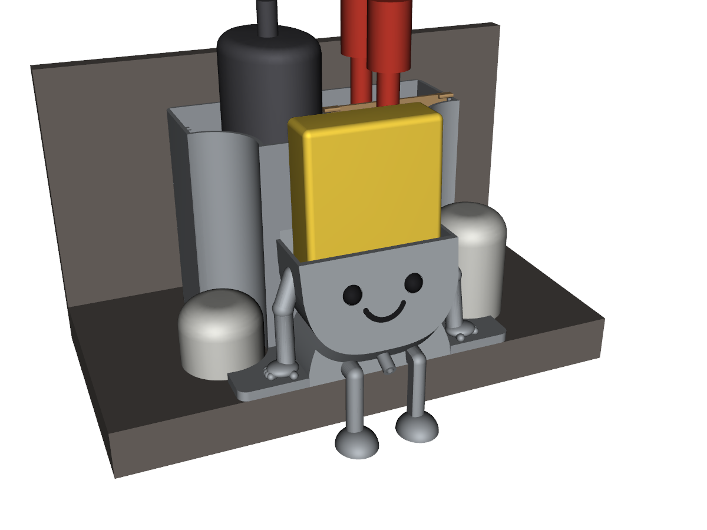

# Sink Buddy

A 3D-printed sink organizer: a leaning smiley-face bowl holds the sponge in front, and a tower behind it holds a soap dispenser and brushes. It sits on the counter between the disposal button and the dishwasher air gap, with arches in its sides that wrap both fixtures so it can't slide. Everything drains forward into the bowl and out a spout between the legs into the sink.



Modeled in Python with [CadQuery](https://github.com/CadQuery/cadquery) and [manifold3d](https://github.com/elalish/manifold). Every dimension is a parameter at the top of `smiley.py`.

## Print files

Ready-to-print STLs, already oriented with no supports, are in [`package/`](package/), with [`package/README.txt`](package/README.txt) for materials, slicer settings and assembly.

| Part | File | Material |
|---|---|---|
| Body | `smiley_body.stl` (175 × 141 × 133 mm) | PETG |
| T insert | `smiley_divider.stl` | PETG |
| Legs | `smiley_leg_left.stl`, `smiley_leg_right.stl` | PETG |
| Feet | `smiley_foot_left.stl`, `smiley_foot_right.stl` (mirror images) | PETG |
| Spout | `smiley_spout.stl` | PETG |
| Eyes, smile | `smiley_eyes.stl`, `smiley_smile.stl` (glued in) | PLA, any color |
| Fit test | `smiley_base_test.stl` (2 mm footprint frame) | anything |

Print the fit test first: lay its front edge on the sink edge and check that both arches clear the fixtures.

## Fitting it to another sink

The site is described by a few parameters in `P` in `smiley.py`:

- `counter_depth`: sink edge to the backsplash
- `fixture_d`, `fixture_spacing`, `fixture_from_wall`, `fixture_clear`: the two round fixtures (diameter, center-to-center, center to the wall, and clearance around them)
- `soap_w`, `soap_l`: the dispenser's footprint
- `sponge_l`, `sponge_h`, `sponge_t`: the sponge, standing on its long edge

## Build

```sh
python3.12 -m venv .venv
.venv/bin/pip install -r requirements.txt

.venv/bin/python smiley.py          # model -> print/ (print poses) and out/ (assembled, with phantoms)
.venv/bin/python render_smiley.py   # previews -> renders/
.venv/bin/python package.py         # print/ -> package/ + sink_buddy_print.zip, sink_buddy_base_test.zip

PYTHONPATH=. .venv/bin/python tools/check.py   # watertight parts, no overlaps, arch spacing
PYTHONPATH=. .venv/bin/python tools/flow.py    # every pocket drains into the bowl
```

`tools/check.py` reports a small overlap for the sponge: a 30 mm sponge rests on the tower wall and gets squeezed slightly at the bottom of the bowl. That's expected.

## Layout

| Path | What |
|---|---|
| `smiley.py` | The model: parameters, layout, every part, print poses |
| `organizer.py` | Shared geometry helpers (and the first, superseded concept) |
| `render.py`, `render_smiley.py` | VTK previews |
| `package.py` | Builds `package/` and the zips |
| `tools/` | Verification scripts |
| `legacy/` | The first concept: its PDF, renders, and web page |
